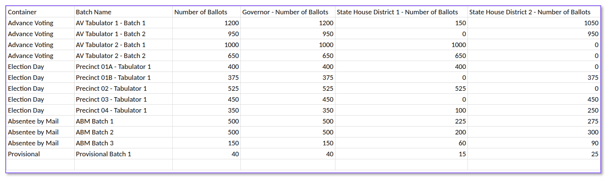

# Ballot Manifests

A key step in the risk-limiting audit process is building a ballot manifest. A ballot manifest is simply a list of all of the ballot containers and the number of ballots inside.

The ballot manifest is used by Arlo to build a list of every ballot in the election. Arlo takes the list of containers and number of ballots and creates a spreadsheet with a line for each ballot and the container that it is in. Later in the process, Arlo uses the list to randomly select ballots and tell the person auditing the ballots where to find each ballot selected.  &#x20;

### **Create a Ballot Manifest**&#x20;

Creating a ballot manifest is slightly different [depending on the type of RLA](../../audit-types.md) you are conducting. Use the tabs below to navigate to the correct instructions for your audit type.



#### **Creating a Standard Ballot Polling/Batch Comparison Ballot Manifest**

1. **Open a spreadsheet program** and create a new spreadsheet.
2. **Add two columns:**
   * **Batch Name:** the name of each container or batch.
   * **Number of Ballots:** the number of ballots in each container.
3. **Enter the data** for your county or jurisdiction, with one row for each container or batch.
4. **Check your numbers.** Make sure the total number of ballots matches your number of ballots cast.
5. **Save the file as a .csv.**

**Ballots Further Separated in the Container​**

If ballots in a container are split into smaller batches that are clearly labeled, include those batches in the ballot manifest. Only do this when each batch has a clear label.

For example, say you scanned ballots in sets of 200 and kept each set together in a folder or with a rubber band. If each set is labeled with its batch and container, list it in the Batch Name column with a comma separating the two, such as “Container Y, Batch X.”

 (1).png>)

 (1).png>)

#### **Creating a Batch Comparison Ballot Manifest Using Card Style Data**

Card style data shows which contests appear on each ballot card. Adding it to the ballot manifest tells Arlo how many ballots in each batch include each contest. This is helpful when a contest only appears on some ballots, such as a district contest.

1. **Start with the standard manifest columns:** Container (if used), Batch Name, and Number of Ballots. Batch names must match the batch names in your candidate totals by batch file.
2. **Pull the card style data from your voting system.** You need the number of ballot cards of each card style in each batch.
3. **Add one column for each target contest.** Name each column with the contest name followed by “- Number of Ballots,” for example “Governor - Number of Ballots.” The contest name must match the contest name in Arlo exactly, or the file won’t line up with the contest.
4. **Fill in each contest column.** For each batch, add up the cards whose card style includes that contest.
   * If a batch has no ballots with the contest, enter 0. Don’t leave the cell blank.
   * If every ballot in the batch has the contest, the number matches Number of Ballots.
5. **Check your numbers.**
   * No contest count should be higher than the batch’s Number of Ballots.
   * For contests on every ballot, the count should equal Number of Ballots.
   * For split districts, the district counts in a batch should add up to the batch total.
6. **Save the file as a .csv** and upload it as your ballot manifest.

<figure><figcaption></figcaption></figure>



1. **Open a spreadsheet program** and create a new spreadsheet.
2. **Add four columns:**
   * **Container (Column A):** the name of each container.
   * **Tabulator (Column B):** the name of the tabulator.
   * **Batch Name (Column C):** the tabulator batch name.
   * **Number of Ballots (Column D):** the number of ballots in each batch.
3. **Enter the data** for your county or jurisdiction, with one row for each batch.
4. **Check your numbers.** Make sure the total number of ballots matches your number of ballots cast.
5. **Save the file as a .csv.**

 (1).png>)



1. **Open a spreadsheet program** and create a new spreadsheet.
2. **Add five columns:**
   * **Container (Column A):** the name of each container.
   * **Tabulator (Column B):** the name of the tabulator.
   * **Batch Name (Column C):** the tabulator batch name.
   * **Number of Ballots (Column D):** the number of ballots in each batch.
   * **CVR (Column E):** enter Y if the batch was centrally counted and is included in your CVR file, or N if it isn’t.
3. **Enter the data** for your county or jurisdiction, with one row for each batch.
4. **Check your numbers.** Make sure the total number of ballots matches your number of ballots cast.
5. **Save the file as a .csv.**

 (1).png>)



### **Number of Ballots in Each Container​**

The number of ballots stored in each container varies by state and jurisdiction. What’s important when creating the ballot manifest is to make sure the number being used is independent of the tabulator. The number of ballots tabulated is generally the right number but that number should have been independently verified on election night or after the election via a reconciliation process that includes comparing it to the number of voters.​​

All voted ballots should be included. Don’t forget provisional, UOCAVA, absentee, or other ballots counted after election day as required by law.  


