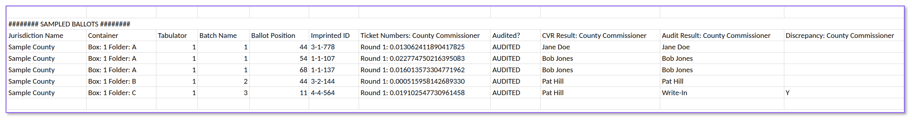

# Audit Report Guide

The audit report generated by Arlo after the completion of a risk-limiting audit contains all of the audit data. This guide explains the data found in each section.

### **Election Info Section**

This election info section provides the basic election information for the audit.

* **Organization:** the name of the jurisdiction conducting the audit.
* **Election Name:** the name of the election being audited.
* **State:** the state of the jurisdiction conducting the audit.

### **Contests Section**

The contests section provides the tabulated results for each contest subject to audit.

* **Contest Name:** the name of the contest audited.
* **Targeted?:** whether the contest was targeted and subject to the risk limit, or opportunistic and not subject to the risk limit.
* **Number of Winners:** the number of winners in the contest.
* **Votes Allowed:** the number of votes allowed in the contest.
* **Total Ballots:** the total number of ballots in the contest. For hybrid audits, this is also listed for the CVR and non-CVR segments.
* **Tabulated Votes:** the tabulated vote totals for each candidate in the contest. For hybrid audits, these are also listed for the CVR and non-CVR segments.

### **Audit Settings Section**

The audit settings section provides all of the settings that were selected to drive the audit.

* **Audit Name:** the name of the audit.
* **Audit Type:** the type of risk-limiting audit selected:
  * Ballot Comparison
  * Ballot Polling
  * Hybrid (Ballot Comparison & Ballot Polling)
  * Batch Comparison
* **Audit Math Type:** the math type used for the audit. Some audit types have more than one option:
  * [SUPERSIMPLE](https://www.usenix.org/legacy/events/evtwote10/tech/full_papers/Stark.pdf) - Ballot Comparison
  * [Card-Style Data](https://dl.acm.org/doi/full/10.1145/3457907) - Ballot Comparison
  * [BRAVO](https://www.usenix.org/system/files/conference/evtwote12/evtwote12-final27.pdf) - Ballot Polling
  * [Minerva](https://arxiv.org/pdf/2008.02315.pdf) - Ballot Polling
  * [PROVIDENCE](https://www.usenix.org/system/files/usenixsecurity23-broadrick.pdf) - Ballot Polling
  * [SUITE](https://arxiv.org/pdf/1809.04235.pdf) - Ballot Comparison & Ballot Polling Hybrid
  * [MACRO](https://papers.ssrn.com/sol3/papers.cfm?abstract_id=1443314) - Batch Comparison
* **Risk Limit:** the risk limit set by the audit administrator.
* **Random Seed:** the random number used to start the audit.
* **Online Data Entry?:** whether the audit administrator chose online or offline data entry.
  * **Online:** audit boards enter data for each ballot individually.
  * **Offline:** the jurisdiction manager enters sample totals.

### **Audit Boards Section**

This audit boards section provides the names and party affiliation (when required) of each audit board.

* **Jurisdiction Name:** the name of the audit board’s jurisdiction.
* **Audit Board Name:** the name of the audit board.
* **Member 1 & 2 Name:** the names of the audit board members.
* **Member 1 & 2 Affiliation:** the party affiliation of the audit board members, when required.

### **Rounds Section**

The rounds section includes the data completed for each round of the audit.

* **Round Number:** the number of the round.
* **Contest Name:** the name of the contest being audited.
* **Targeted?:** whether the contest was targeted and subject to the risk limit, or opportunistic and not subject to the risk limit.
* **Sample Size:** the number of ballots retrieved for the contest during that round.
* **Risk-Limit Met?:** Yes or No, showing whether the sample met the risk limit.
* **P-Value:** the risk measurement for that round and contest.
* **Start Time:** the time the round was launched.
* **End Time:** the time the last audit board signed off in that round.
* **Audited Votes:** the audited sample vote totals for that round and contest.


Batch comparison audit reports include three additional columns in the Rounds section:

* **Batches Sampled:** the number of batches sampled for that round and contest.
* **Ballots Sampled:** the total number of ballots in the sampled batches.
* **Reported Votes:** the reported vote totals for the sampled batches in that round and contest.


### **Sampled Ballots/Batches Section**

The sampled ballots/batches section includes data on each ballot/batch sampled.

#### Ballot Comparison Example

<figure><figcaption></figcaption></figure>

#### Ballot Polling Example

<figure><figcaption></figcaption></figure>

#### Batch Comparison Example

<figure><figcaption></figcaption></figure>

### Report Columns and Definitions

* **Jurisdiction Name:** the name of the ballot’s jurisdiction.
* **Container:** the container the ballot was retrieved from (if applicable).
* **Tabulator:** the tabulator used to scan the ballot (if applicable).
* **Batch Name:** the name of the batch the ballot was retrieved from. This may include the container name.
* **Ballots in Batch:** the number of ballots in the batch (batch comparison audits only).
* **Ballot Position:** the ballot’s position within its batch (not applicable to batch comparison audits).
* **Imprinted ID:** the tabulator imprint ID from the voting system (ballot comparison and hybrid audits only).
* **Ticket Numbers:** the order in which the ballot was randomly selected.
* **Audited?:** the ballot’s audit status:
  * AUDITED: the ballot was audited.
  * NOT\_AUDITED: the ballot was not audited.
  * NOT\_FOUND: an audit was attempted, but the ballot was not found.
  * Yes: the batch was audited (batch comparison audits only).
* **Reported Results:** the votes as reported in the candidate totals by batch file (batch comparison audits only).
* **CVR Result:** the vote(s) recorded in the voting system’s cast vote record (CVR) for the audited ballot (ballot comparison and hybrid audits only).
* **Audit Result:** the vote(s) recorded from the ballot or batch for that contest. Besides candidate or proposal votes, this may show:
  * BLANK: no votes were cast in the contest.
  * CONTEST\_NOT\_ON\_BALLOT: the contest was not on the audited ballot.
* **Discrepancy:** shows Y when the CVR result and the audit result don’t match (ballot comparison audits only).
* **Change in Results:** the differences between the reported and audited results (if applicable).
* **Change in Margin:** the difference in vote margin between the reported and audited results (if applicable).
* **Last Edited By:** the Jurisdiction Manager or Audit Board member who entered the audit results.
* **Combined Batch:** the batches that were combined into this batch, if any (batch comparison audits only).
